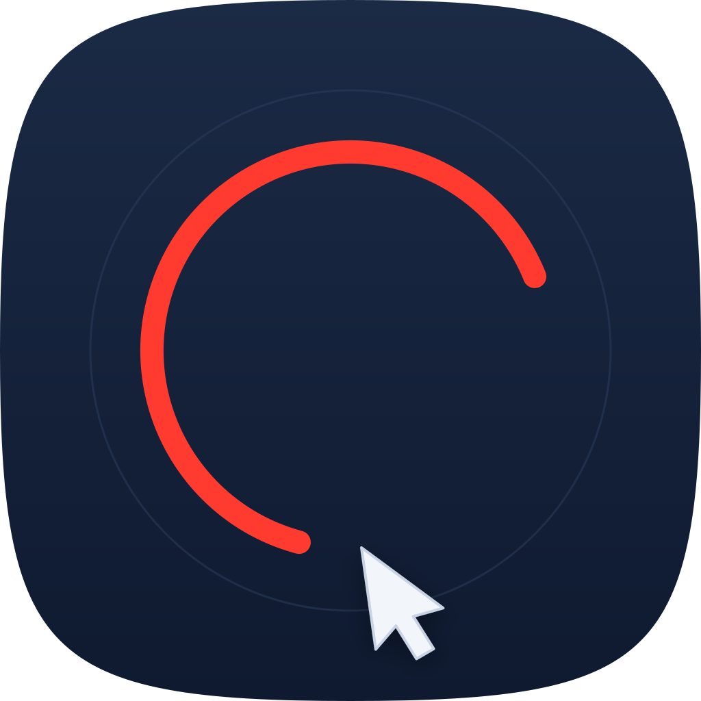

<p align="center">
  
</p>

<h1 align="center">Brushtastic</h1>

<p align="center">
  Draw temporary annotations anywhere on your Mac screen — they fade away on their own.
</p>

---

Brushtastic is a tiny macOS menu bar app for presentations, screen sharing, demos and recordings.
Press a global shortcut, draw on top of everything, and the strokes disappear by themselves a few
seconds later. When drawing mode is off, the overlay is completely click-through, so it never gets
in your way.

## Features

- **Global shortcut ⌃⌥D** (Control + Option + D) toggles drawing mode from any app.
- **Draws over everything** — every display, every Space, and full-screen apps.
- **Click-through when off** — mouse clicks go straight to the apps underneath.
- **Strokes fade out automatically** — after 3 seconds by default, adjustable from 0.5 to 10 seconds.
  Drag the slider all the way to the right and strokes **never** fade.
- **Four tools**, switched with the number keys while drawing:

  | Key | Tool          | With ⇧ Shift held              |
  | --- | ------------- | ------------------------------ |
  | `1` | Freehand      | —                              |
  | `2` | Circle        | Perfect circle                 |
  | `3` | Rectangle     | Perfect square                 |
  | `5` | Straight line | Snaps to 45° angles            |

- **Multiple displays** — a single stroke can cross from one screen to the next.
- **Colors and line widths** — red, yellow, green, blue, pink, white or black; thin, medium or thick.
- **Launch at login** — one click in the menu.
- **No Dock icon** — lives only in the menu bar.
- **Norwegian and English** — shown in Norwegian when macOS's preferred language is Norwegian
  (Bokmål, Nynorsk or "Norsk"), otherwise English.
- **No special permissions** — the shortcut does not require Accessibility access.

## Usage

| Action                         | How                                         |
| ------------------------------ | ------------------------------------------- |
| Start / stop drawing           | ⌃⌥D, or **Start Drawing** in the menu bar   |
| Choose a tool                  | `1`, `2`, `3` or `5` while drawing          |
| Constrain shape / line angle   | Hold ⇧ Shift while dragging                 |
| Clear everything               | Right-click while drawing, or **Clear All** |
| Exit drawing mode              | `Esc` or ⌃⌥D                                |
| Change fade-out delay          | Slider in the menu bar menu                 |

While drawing mode is on, the screen gets a faint tint and an accent-colored border, and a toolbar
at the top of the screen shows which tool is selected.

## Installation

### Download

1. Download `Brushtastic.zip` from the [latest release](../../releases/latest).
2. Unzip it and move **Brushtastic.app** to `/Applications`.
3. The app is not notarized by Apple, so the first time you open it macOS will block it.
   Go to **System Settings → Privacy & Security** and click **Open Anyway**, or run:

   ```sh
   xattr -dr com.apple.quarantine /Applications/Brushtastic.app
   ```

### Build from source

Requires macOS 13 or later and the Xcode Command Line Tools (full Xcode is not needed).

```sh
git clone https://github.com/Gauteweb/Brushtastic.git
cd Brushtastic
./build.sh
open build/Brushtastic.app
```

`build.sh` compiles the app with Swift Package Manager, generates the app icon from `ikon.svg`,
assembles `build/Brushtastic.app` and signs it ad hoc. The version number is set at the top of
`build.sh`.

> If you enable **Launch at Login**, run the app from `/Applications` — the login item points to
> the app's location, and `build/` is recreated on every build.

## Project structure

| File                                    | Purpose                                                  |
| --------------------------------------- | -------------------------------------------------------- |
| `Sources/Brushtastic/AppDelegate.swift` | Menu bar item, menu, drawing mode, display/Space changes |
| `Sources/Brushtastic/Overlay.swift`     | Transparent per-screen overlay, input, rendering         |
| `Sources/Brushtastic/StrokeStore.swift` | Strokes and shapes, fade-out animation                   |
| `Sources/Brushtastic/Tool.swift`        | Drawing tools                                            |
| `Sources/Brushtastic/HotKey.swift`      | Global shortcut (Carbon `RegisterEventHotKey`)           |
| `Sources/Brushtastic/Settings.swift`    | User preferences (`UserDefaults`)                        |
| `Sources/Brushtastic/Localization.swift`| Norwegian and English strings                            |
| `build.sh`                              | Builds and packages the `.app`                           |
| `ikon.svg`                              | App icon source                                          |

## Known limitations

- The ⌃⌥D shortcut cannot be changed. If another app already uses it, start drawing from the menu.
- The app is signed ad hoc and not notarized, so Gatekeeper asks for confirmation on first launch.

## License

Brushtastic is released under the [MIT License](LICENSE).
